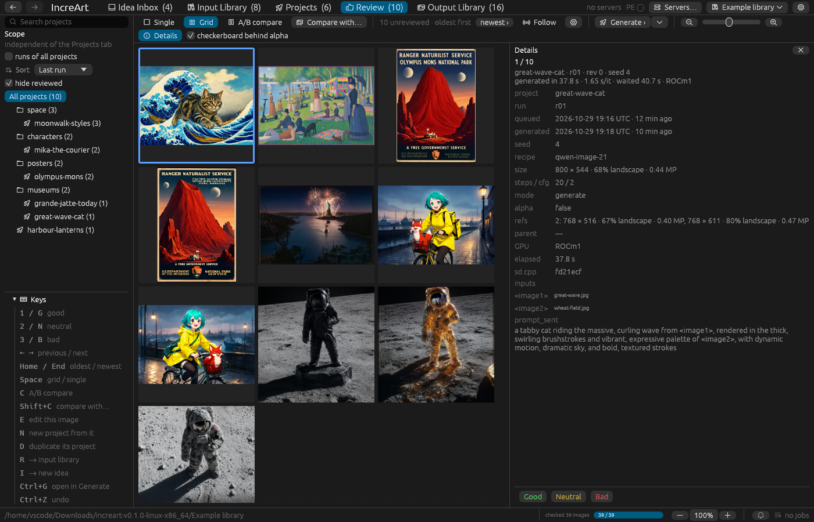
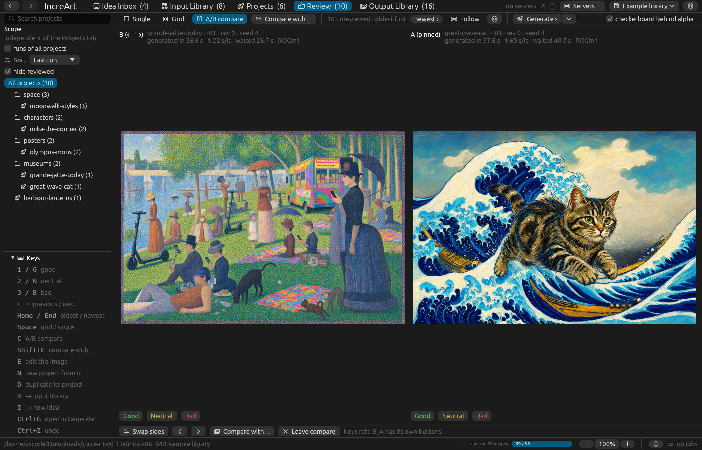
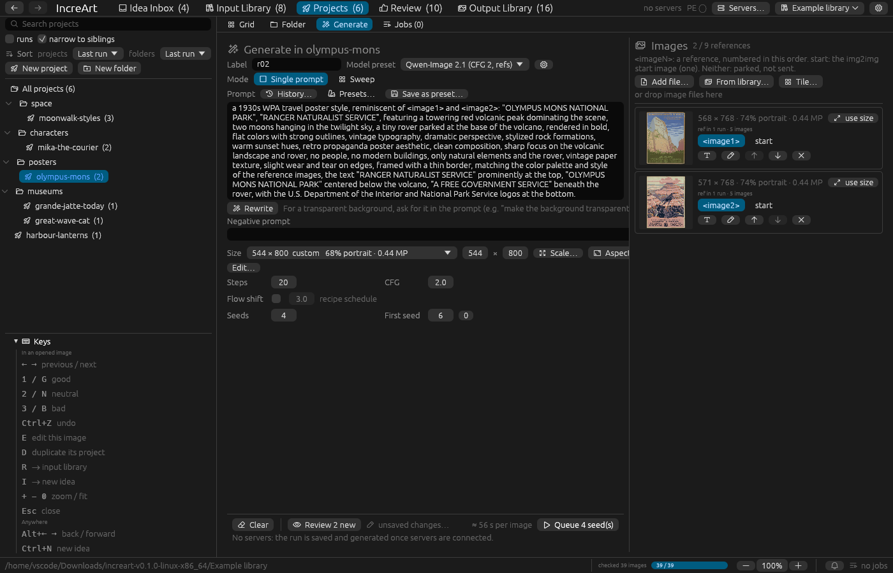
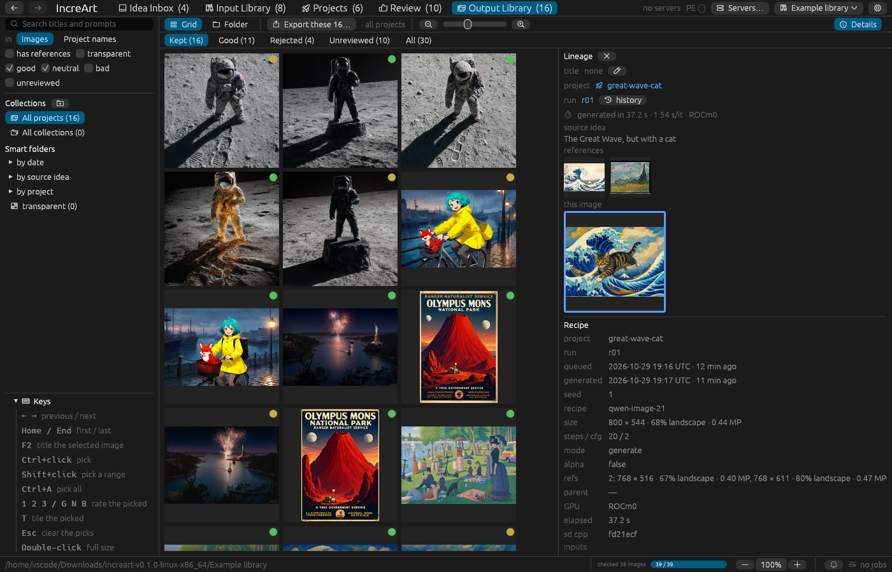
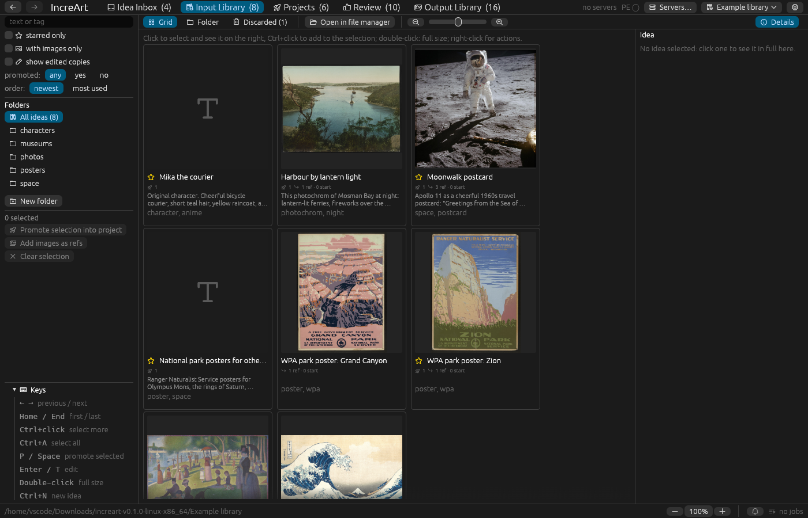

# IncreArt

A desktop app for making images with **Qwen-Image 2.1** on your own GPUs,
built around fast review. Collect ideas, turn them into projects, generate
many seeds across every GPU you have, and sort the results with the keyboard.
Every image keeps the recipe that made it.



## What it does

- **Two review queues.** Ideas (text, images, or both) land in an *Idea
  inbox*. Keep the good ones in the *Input library*. Generated images land in
  *Review*, and the ones you keep go to the *Output library*. Both queues use
  the same keys: `1`/`G` good, `2`/`N` neutral, `3`/`B` bad, arrows to move,
  `Ctrl+Z` to undo.
- **Projects, runs and seeds.** A project holds runs, and a run is one prompt
  over many seeds. Runs are spread across all your GPUs and queued as jobs.
- **Text-to-image and editing with references.** Point the prompt at
  reference images (`image1`, `image2`, …) from your libraries or from
  earlier outputs.
- **Prompt enhance.** An optional Qwen3-VL chat model rewrites or expands
  prompts, fills `{blanks}`, and describes images. The original prompt is
  always kept beside the rewritten one.
- **Sweeps.** Vary a setting, a model or a blank across runs and compare them
  on a contact sheet.
- **A/B compare**, against other outputs or against the input images.
- **Full lineage.** idea → project → run → image, and back from any image to
  its references and parent. The recipe is embedded in each file, so every
  image can be made again.
- **Transparent (RGBA) output** kept end to end.
- **Folder views, collections and smart folders** over your libraries, and
  export.
- **Backends you run locally:** [KoboldCpp](https://github.com/LostRuins/koboldcpp)
  (a setup wizard picks settings for your GPUs' VRAM) or stable-diffusion.cpp's
  `sd-server`.

| | |
|---|---|
|  |  |
| **A/B compare** in Review | **Generate**, with references |
|  |  |
| **Output library** and lineage | **Input library** of kept ideas |

The screenshots show the [example library](#example-library). Its source
images are public domain, and everything else in it was generated by
Qwen-Image 2.1 in IncreArt.

## Getting started

Download the zip for your platform from [Releases](../../releases), unzip
it anywhere, and run `increart` (`increart.exe` on Windows). It's portable:
nothing is installed. The builds aren't signed, so Windows and macOS may
ask you to confirm the first time you run them.

On first run, IncreArt offers the [example library](#example-library) that
comes in the zip, or a new library of your own, then asks for the servers
to use. **Set up KoboldCpp for your GPUs…** in the server dialog is the
easiest start.

The [setup guides](docs/setup/README.md) go step by step: get the models,
install KoboldCpp or sd-server, configure them, or build IncreArt from
source. They're written so that a coding agent can follow them too
([`llms.txt`](llms.txt) indexes them).

To build it yourself:

```sh
cargo build --release -p increart-gui
./target/release/increart
```

### Requirements

- A GPU with at least 8 GB of VRAM; more VRAM is faster
  (see [VRAM tiers](docs/vram-tiers.md)).
- The Qwen-Image 2.1 model files: 10–13 GiB for KoboldCpp, 16 GiB for
  sd-server ([models guide](docs/setup/02-models.md)).
  IncreArt doesn't include or redistribute model weights; they carry their
  own licences.
- Rust (stable) to build.

IncreArt is developed and tested on Linux with AMD GPUs (ROCm and Vulkan).
CI builds and tests it on Windows and macOS, but nobody has generated images
on those platforms yet. Reports are welcome.

## Example library

Each release zip has an `Example library` folder beside the app: a small
library to explore before you generate anything, with ideas, six projects
and 30 reviewed and unreviewed outputs. It's in the start-up list the first
time you run IncreArt. It's an ordinary library, so changes you make to it
are saved, and you can remove it from the list with ×. It takes about 45 MB;
the Windows zip's copy is about 90 MB, because Windows can't unzip the
links it uses elsewhere, so it holds copies instead.

Its source images come from the Library of Congress, The Metropolitan Museum
of Art, the Art Institute of Chicago and NASA, and all of them are public
domain or have no known restrictions. `credits.json` in that folder lists
each one with its source page. `scripts/demo-sources.py` and
`scripts/demo-library.json` rebuild it from scratch, and
`scripts/package-demo-library.sh` packages it for the release workflow.

## Documentation

- [Setup guides](docs/setup/README.md): install, models, backends,
  configuration, troubleshooting.
- [Design](docs/DESIGN.md): how everything works, in detail.
- [VRAM tiers](docs/vram-tiers.md) and [backend performance](docs/backend-performance.md).
- [Screens](docs/gui/README.md): every screen of the app.

## Contributing

Bug reports and ideas are very welcome as [issues](../../issues/new/choose).
Pull requests aren't accepted; [CONTRIBUTING.md](CONTRIBUTING.md) explains why
and what makes a good report.

## Licence

[MIT](LICENSE). Model weights, KoboldCpp and stable-diffusion.cpp are separate
projects under their own licences.
